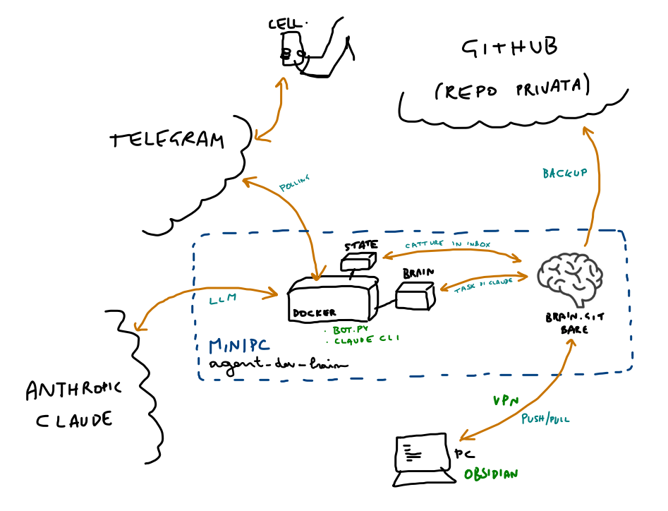

# agent-dev-brain

Un server casalingo per un "secondo cervello" in Markdown, cioè un vault Obsidian versionato con git. Questo sistema fa due cose:

1. **Repo centrale con backup.** Un repo git bare (vault centrale) sul server: il mio PC fa push e pull lì, e, se vuoi, il server lo copia su GitHub a ogni push.
2. **Bot Telegram con Claude Code.** Dal telefono mando un'istruzione ("riassumi le note di ieri in una nota di sintesi") e Claude Code, in modalità headless dentro un container Docker, la esegue su un clone del vault, poi fa commit e push. Messaggi inoltrati, foto e documenti invece vengono salvati così come sono in `inbox/`, senza passare da Claude.



Il bot per Telegram è pensato per **una sola persona**: risponde a un solo user id Telegram, nella chat privata e ignora tutti gli altri.

## Requisiti

- Un server **Ubuntu o Debian** sempre acceso (va bene un mini PC), con un utente che può usare `sudo`. Tutto il resto, Docker compreso, lo installa l'installer.
- Un **bot Telegram nuovo**, creato con @BotFather (ti dà il token), e il tuo **user id** numerico (te lo dice @userinfobot).
- Un **abbonamento Claude** (Pro o Max) oppure una **chiave API** Anthropic, a consumo.

Facoltativi:
- un **repo GitHub privato** per il backup. Se contiene già un vault viene importato, altrimenti crealo vuoto, senza README;
- la **chiave SSH pubblica del PC** (`~/.ssh/id_ed25519.pub`), per lavorare sul vault anche dal PC. Il server deve essere raggiungibile via SSH: in rete locale, oppure da fuori con una VPN.

## Installazione

Sul server:

```bash
git clone https://github.com/giuliopons/agent-dev-brain.git && cd agent-dev-brain
sudo bash install.sh
```

L'installer fa le domande una alla volta: token Telegram, user id, fuso orario, repo GitHub e chiave del PC (queste due si possono saltare). Poi:
1. crea l'utente `brain` e il repo centrale `/home/brain/brain.git`, che rifiuta force push e cancellazioni;
2. se hai indicato GitHub, ti mostra una deploy key da aggiungere al repo (Settings → Deploy keys, con "Allow write access") e aspetta che funzioni;
3. installa Docker e crea la chiave SSH del bot, valida solo per git e solo dal server stesso;
4. riempie il vault: lo importa da GitHub se c'è, altrimenti crea un **vault vuoto** da `template/`, con le cartelle PARA (`inbox/`, `projects/`, `areas/`, `resources/`, `archive/`), un `CLAUDE.md` con le regole delle note e l'hook gitleaks;
5. costruisce l'immagine e ti fa scegliere l'accesso a Claude: per l'abbonamento lancia `claude setup-token` (apri il link, accedi, incolla il codice e poi il token che stampa);
6. avvia il bot e stampa i comandi per il PC.

Si può rilanciare quando vuoi: salta quello che è già fatto e ripropone le domande facoltative rimaste senza risposta. Per autorizzare un altro PC:

```bash
sudo bash install.sh --pc-key "$(cat chiave_del_pc.pub)"
```

**Dal PC**, con la chiave autorizzata:

```bash
git clone brain@<server>:brain.git
git -C brain config core.hooksPath .githooks   # controllo dei segreti anche sul PC (serve gitleaks)
```

Da qui in avanti il PC lavora con il server, non con GitHub: GitHub è solo una copia. Se fai push su GitHub direttamente dal PC, le due storie si separano e il mirror smette di funzionare.

**Hai già un vault?** Mettilo in un repo GitHub privato prima dell'installazione e indica quel repo: l'installer lo importa. Lo stesso vale per **rifare il server da zero**, per esempio dopo la rottura del disco: stesso comando, stesso repo GitHub, e il vault torna com'era (`.env` e `state/` vengono ricreati).

## Uso

Da Telegram:
- **un messaggio di testo** è un task per Claude: risponde con l'esito e l'hash del commit;
- **messaggi inoltrati, foto, documenti e video** vengono salvati grezzi in `inbox/`, con gli allegati in `inbox/attachments/` e un album in una sola nota. Arrivano subito, anche mentre Claude sta lavorando;
- **`/in <testo>`** salva un testo parola per parola;
- **comandi:** `/new` (nuova conversazione), `/undo` (annulla l'ultimo task di Claude; si può ripetere. Le catture non si annullano: se dopo il task ci sono catture o commit dal PC, chiede conferma con `/undo_si`), `/status`, `/log`.

I vocali non sono supportati.

Sul server:
```bash
sudo docker compose ps                  # sta girando?
sudo docker compose logs -f             # log del bot (Ctrl+C per uscire)
sudo docker compose restart             # dopo aver modificato bot.py
sudo docker compose up -d               # avvio (riparte da solo anche dopo un reboot)
sudo docker compose exec agent-dev-brain bash # shell nel container
sudo tail -3 /home/brain/mirror.log     # esito delle copie su GitHub
```

Tutti i comandi docker vogliono `sudo`, di proposito: chi è nel gruppo `docker` ha di fatto i permessi di root, e quindi li avrebbe ogni processo che gira con il tuo utente.

**Aggiornare Claude Code:** `sudo docker compose build --no-cache && sudo docker compose up -d`. L'aggiornamento automatico dentro il container è spento (`DISABLE_AUTOUPDATER=1`).

## Sicurezza: cosa protegge e cosa no

Un bot che fa scrivere un'IA su un repo partendo da messaggi Telegram va installato sapendo dove sono i confini.

**Cosa protegge**
- **Chi può dare ordini.** Solo `ALLOWED_USER_ID` e solo in chat privata. Gli altri vengono ignorati senza risposta.
- **Testi di terzi.** Un messaggio inoltrato non diventa mai un'istruzione per Claude: viene solo salvato.
- **La storia del vault.** `brain.git` rifiuta force push e cancellazioni di branch: ogni modifica si annulla con `git revert` (`/undo`), e GitHub ha una copia.
- **Accesso al repo centrale.** La chiave del bot è in `authorized_keys` con `restrict,from="127.0.0.1,::1"`: solo git (git-shell), niente tunnel, valida solo dal server stesso.
- **Segreti nelle note.** Ogni commit del bot passa da gitleaks: tramite l'hook `.githooks/pre-commit` del vault se c'è, altrimenti direttamente. Il wrapper `/opt/githooks/pre-commit` è di root, quindi l'agente non può modificarlo (lo script del vault sì: vedi sotto).
- **Il server.** Claude gira in un container, con un utente non root e un limite di 1 GB di memoria. `.env` resta fuori dal container, e il token Telegram viene tolto dall'ambiente passato a Claude.

**Cosa NON protegge**
- **Prompt injection rimandata.** Gli inoltri finiscono in `inbox/` senza passare da Claude, ma quando poi chiedi a Claude di sistemare l'inbox li legge, e un testo malevolo può contenere istruzioni. Lo stesso vale per le pagine web che Claude apre.
- **Gli strumenti di Claude non sono limitati.** Claude viene lanciato con `--dangerously-skip-permissions`. Con quel flag, `--allowedTools` non restringe niente: Claude ha shell completa e accesso al web dentro il container. Il confine vero è il container, che usa `network_mode: host` (serve per arrivare a `127.0.0.1:22`) e quindi raggiunge anche i servizi in ascolto in locale sul server.
- **I segreti nell'ambiente di Claude.** Il token di Claude è per forza nel suo ambiente. Il token Telegram ne è escluso, ma un'istruzione malevola potrebbe comunque leggerlo dal processo del bot, che gira con lo stesso utente. gitleaks ferma gli errori, non chi lo aggira con `git commit --no-verify` o modificando `.githooks/pre-commit` nel vault.
- **Il tuo account Telegram.** Chi controlla il tuo account controlla il bot.

## File

| Percorso | Cosa |
|---|---|
| `bot.py` | il bot (montato nel container: dopo una modifica basta `restart`) |
| `Dockerfile`, `docker-compose.yml` | immagine e servizio |
| `install.sh` | installazione e reinstallazione: utente `brain` (git-shell), `brain.git`, mirror su GitHub con cron orario di recupero, Docker, chiave del bot, clone, `.env`, avvio |
| `template/` | il vault vuoto creato al primo avvio, se non c'è niente da importare |
| `.env` (600, non versionato) | `TELEGRAM_TOKEN`, `ALLOWED_USER_ID`, `CLAUDE_CODE_OAUTH_TOKEN` o `ANTHROPIC_API_KEY`, `TZ`, `AGENT_UID`/`AGENT_GID` |
| `brain/` (non versionato) | clone del vault su cui lavora l'agente (autore `agent-dev`) |
| `state/capture/` | secondo clone, usato solo per la cattura in `inbox/`. Così le catture non finiscono nei commit dei task e `/undo` non le annulla |
| `state/agent.log` | una riga per task: data, istruzione, esito, hash |
| `state/session.json` | sessione Claude corrente (`/new` la cancella) |
| `state/claude/` | config e sessioni di Claude Code (`~/.claude` del container) |
| `state/ssh/` | chiave del bot, known_hosts, config (montata read-only) |
| `tests/test_capture.py`, `tests/test_undo.py` | test end-to-end di cattura e `/undo`, con repo temporanei |

## Test

```bash
python3 -m venv /tmp/ptb && /tmp/ptb/bin/pip install -q python-telegram-bot==22.8
/tmp/ptb/bin/python tests/test_capture.py
/tmp/ptb/bin/python tests/test_undo.py
```

## Se qualcosa va storto

- **Il bot non risponde** → `sudo docker compose ps` e `logs`. Token revocato? `.env` salvato?
- **"Claude è uscito con errore"** → token scaduto (dura circa un anno): `sudo docker compose run --rm agent-dev-brain claude setup-token`, nuovo valore in `.env`, `sudo docker compose up -d`. Se l'errore parla di sessione: `/new`.
- **Task fallito o commit rifiutato da gitleaks** → le modifiche sono in `git stash` del clone: `git -C brain stash list`, `stash show -p`, poi `stash drop` (o `pop` per recuperarle).
- **pull --rebase fallito** → conflitto con un commit fatto altrove. Il bot si ferma senza toccare niente: risolvi a mano in `brain/`. Per usare git dall'host: `GIT_SSH_COMMAND="ssh -i state/ssh/id_ed25519 -o UserKnownHostsFile=state/ssh/known_hosts -o IdentitiesOnly=yes"`.
- **Cattura "❌ Non salvato"** → l'errore è nel messaggio. Se il commit è stato rifiutato da gitleaks, la nota è in `git -C state/capture stash list`. Un push fallito resta committato nel clone di cattura e riparte con la cattura successiva.
- **`ERRORE push GitHub` in `mirror.log`** → deploy key mancante o senza permesso di scrittura, oppure qualcuno ha fatto push su GitHub direttamente. Per riprovare a mano: `sudo -u brain -H /home/brain/bin/mirror.sh`.
- **Chiave del bot compromessa** → togli la sua riga da `/home/brain/.ssh/authorized_keys`, cancella `state/ssh/id_ed25519*` e rilancia `sudo bash install.sh`, che ne crea una nuova.
- **Token Telegram compromesso** → @BotFather `/revoke`, nuovo token in `.env`, `sudo docker compose up -d`.

## Licenza

MIT
